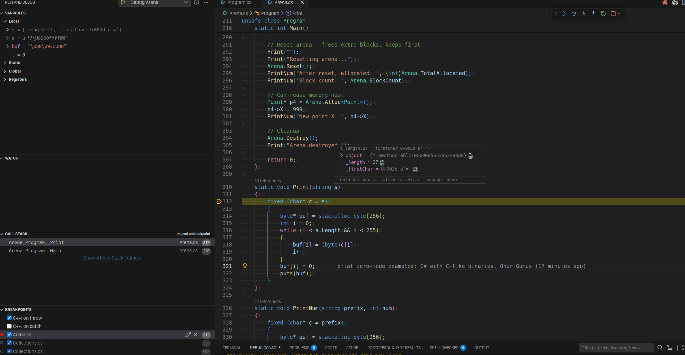

# bflat Zero Mode Examples



Exploring [bflat](https://flattened.net/)'s zero mode: C# compiled to tiny native binaries without .NET's runtime, written in **C# 15** under the **updated memory safety rules**.

**Zero mode is essentially "C with proper generics"**: C#'s syntax, type safety, and generics with C-like binary sizes (16-160 KB).

**Without cloning:** on Linux with the .NET 10 SDK, `dotnet new install ZeroCSharp.Templates`, `dotnet new zero -o Hello`, `cd Hello && dotnet build` makes a native program; `-p:ZeroTarget=win-x64` makes a Windows one. The packages are built from [`sdk/`](sdk/); see [Install with dotnet](https://onurgumus.github.io/zero-csharp/get-started/install-with-dotnet.html).

**Documentation:** <https://onurgumus.github.io/zero-csharp/>, a guide to installing the fork, a tutorial, concepts, task guides and a reference for `lib/`. Its source is in `docs/`; build it with `dotnet tool restore && python3 scripts/build-docs.py` (needs .NET 10, Python 3 and Node), then `python3 -m http.server -d output`.

The samples don't use bflat's built-in zero-mode library (`--stdlib:zero`, zerolib). They use [`zerocore/`](zerocore/README.md), an MIT-licensed core library in this repo that `build.sh` compiles from source, so nothing AGPL-licensed is linked into the binaries (see [Core library](#core-library)).

## Quick start

```bash
./setup.sh            # checks prerequisites (+ builds the container image on macOS)
./build.sh            # builds every sample into ./bin
./build.sh Arena      # or just one
./run.sh Arena        # runs it (in the container on macOS)

./setup.sh --wasm     # WebAssembly: also downloads the toolchain (see below)
./build.sh --wasm     # builds every sample into ./bin/wasm/*.wasm
./run.sh --wasm Arena # runs it with wasmtime

./setup.sh --dos      # DOS on a 386: downloads FreeDOS and a DOS extender (see below)
./build.sh --dos      # builds the samples into ./bin/dos/*.exe
./run.sh --dos Casts  # runs one under FreeDOS in an emulator (--dos --window shows the screen)
./run.sh --dos --window Vga   # a small game: arrow keys steer, Esc quits

./test.sh             # builds and checks everything (see Testing)
```

Prerequisites:

- **The bflat fork** (see below). By default `../bflat/layouts/linux-glibc-<arch>`; override with `BFLAT_DIR`.
- **macOS:** Docker. bflat is a Linux program, so it runs in a Linux container of your Mac's own architecture (native on Apple Silicon). By default the samples are Linux programs that run in that container too; `./build.sh --mac` builds macOS programs instead (see [macOS](#macos)), which also needs Xcode or its command line tools.
- **Linux:** an assembler (`as`, from binutils) for zerocore's assembly routines: `sudo apt install binutils`. bflat's linker needs nothing else (layouts built before the fork switched to LLVM 20's lld, on 2026-11-21, need `libtinfo.so.5`: rebuild them). Cross-compiling needs the target's assembler too (`binutils-x86-64-linux-gnu` or `binutils-aarch64-linux-gnu`).

Windows programs: `./build.sh --win` builds every sample as a 64-bit Windows program (see [Windows](#windows)). Building *on* Windows is another matter: `.\setup.ps1` and `.\build.ps1` use the fork's `windows-x64` layout but are **untested**, and still build against zerolib rather than zerocore.

## Getting bflat

The samples need a bflat fork, [OnurGumus/bflat](https://github.com/OnurGumus/bflat) (branch `master`). `build.sh` uses it as a compiler only: the first, fourth, fifth and sixth items below. The rest are changes to the fork's zerolib, which matter if you build with `--stdlib:zero` (as `build.ps1` still does). The fork differs from upstream bflat 10.0.0-rc.1 in these ways:

- **It compiles C# 15.** Roslyn is bumped to 5.12.0, the version shipped with the .NET 11 SDK. A new `--compiler-feature` option (the same as `csc -features:`) turns on the updated memory safety rules.
- **SIMD.** zerolib defines `Vector64/128/256<T>` (with `Create` and `As*`) and a subset of the hardware intrinsics: `AdvSimd` and `Dp` (SDOT) on arm64; `Sse`, `Avx`, `Avx2` and `Fma` on x64. That covers float arithmetic, FMA, min/max, rounding, conversions, divide and int8 dot products. The compiler treats them as real intrinsics.
- **Atomics and half floats.** `Interlocked` (compiled to `lock xadd`/`cmpxchg` and `ldaxr`/`stlxr`), `Volatile`, `Half`, `BFloat16` and the `BitConverter` bit conversions. Half/BFloat16 conversions are bit-for-bit identical to .NET 11's.
- **Instruction sets beyond the baseline come only from `-m`.** Zero mode has no run-time CPU detection, and upstream bflat failed to link on arm64 when code checked e.g. `Dp.IsSupported` without `-m`. Now such checks are simply `false` unless the instruction set is given with `-m`.
- **`--os macos`.** The compiler writes a Mach-O object file for macOS on arm64 or x64. bflat has no Mach-O linker, so this needs `-c` and `--stdlib:none`, and the object is linked on a Mac with clang (see [macOS](#macos)).
- **The .NET 10 GA JIT.** Upstream bflat 10.0.0-rc.1 ships the .NET 10 RC1 JIT, which miscompiles some static-field stores on x64. The fork's build swaps in Microsoft's GA JIT, which fixes them.
- **zerolib fixes.** `ThrowOverflowException` is added, so checked arithmetic and **integer division on arm64** compile. `Console.WriteLine(int)` is fixed.
- **Strings, arrays, statics and casts in zerolib.** Upstream zero mode can't compile or run a lot of ordinary C#; the fork makes these work:
  - `string` gets `==`, `!=`, `Equals`, `IsNullOrEmpty` and `Concat`, so `a == b`, `a + b` (string operands) and `switch` on strings compile. `+` allocates with malloc and is never freed, like every allocation in zero mode.
  - Static fields of reference types (`static string`, objects, arrays). Upstream segfaults on the first store: the compiler expects the runtime to allocate their storage at startup, and zerolib didn't. It now does, before `Main`.
  - `new T[n]` links (`RhpNewArrayFast`/`RhpNewPtrArrayFast`). Arrays of reference types (`string[]`, `object[]`) and class casts (`(T)x`, `is`, `as`) compile (`System.Runtime.TypeCast`). Casts to interface and array types still aren't supported.
  - Top-level statements, which need a `string[] args`.
  - Static constructors that build strings no longer crash the compiler: its static preinitializer looks up string's length field by its CoreLib name, `_stringLength`.
  - `new` zeroes memory (calloc instead of malloc), as C# requires.
- **A WASI build of zerolib** (`lib/wasi/wasm/zerolib.dll`), for [WebAssembly](#webassembly). It calls WASI's C library directly (no `libSystem.Native`) and uses 32-bit pointers.

  To update only zerolib in existing layouts, without the full build below, run `bflat build-il --deterministic --stdlib:none -d LINUX -d ARM64 -o:<layout>/lib/linux/arm64/zerolib.dll` (and so on per target) in `src/zerolib`, as `src/bflat/bflat.csproj` does; then rebuild `arenalib`, which references it.

The fork is AGPL-3.0, like upstream bflat's source. Binaries built with `--stdlib:zero` contain its zerolib; binaries built by `build.sh` don't (see [Core library](#core-library)).

Building the fork needs a GitHub token with **only** `read:packages` (bflat's packages live on GitHub Packages), and runs in an x64 .NET 10 container:

```bash
cd ../bflat
# src/bflat/NuGet.config (gitignored) reads the token from BFLAT_PACKAGES_TOKEN
# (the token file is mounted read-only, so it never appears on a command line)
docker run --rm --platform linux/amd64 -v "$PWD:/src" -w /src \
  -v ~/.config/bflat/packages-token:/run/token:ro \
  mcr.microsoft.com/dotnet/sdk:10.0 bash -c \
  'BFLAT_PACKAGES_TOKEN=$(cat /run/token) dotnet build src/bflat/bflat.csproj -t:BuildLayouts -c Release'
```

This produces `layouts/linux-glibc-{x64,arm64}` and `layouts/windows-{x64,arm64}`, and takes about 15 minutes under emulation.

## Core library

Every C# program needs a core library: the assembly that defines `object`, `int` and `string`, and holds the runtime code the compiler calls to allocate objects, check casts and set up static fields. .NET's is `System.Private.CoreLib` plus a native runtime, megabytes of it. bflat's zero mode replaces both with zerolib, about 4,000 lines, which is AGPL-3.0 and gets compiled into every binary.

[`zerocore/`](zerocore/README.md) is this repo's replacement for zerolib: about 2,400 lines of C# and three short assembly routines per architecture, under the MIT license. `build.sh` compiles it from source and passes it to bflat with `--stdlib:none`. Compared with zerolib it adds casts to interfaces, interface calls the compiler can't resolve at build time, boxing, and `Main(string[] args)`; it leaves out `Console` and `Half`, and it runs on Linux, macOS on Apple Silicon, Windows x64, WebAssembly and DOS (through the WebAssembly build's bitcode). Its README lists what works, what doesn't, and where the code comes from, including a caveat about the license that's worth reading before building a product on it.

The same program comes out about 10 KB smaller than with zerolib, except Tiny, which is 0.6 KB larger.

## Building

`zerocore/` and `lib/` are each compiled once into an IL assembly, and each sample references them with `-r`:

```bash
F="--langversion preview --compiler-feature updated-memory-safety-rules"
bflat build-il $(find zerocore -name '*.cs') -O --stdlib:none --langversion preview \
    -o bin/System.Private.CoreLib.dll
as zerocore/native/arm64.S -o bin/zerocore-arm64.o
bflat build-il lib/*.cs -O --stdlib:none -r bin/System.Private.CoreLib.dll $F \
    --target Shared -o bin/BflatLib.dll
bflat build samples/Arena.cs -r bin/BflatLib.dll -r bin/System.Private.CoreLib.dll \
    --stdlib:none --no-reflection -i libc $F --ldflags bin/zerocore-arm64.o -o bin/Arena
```

This is how you ship a bflat library without header files. The assembly's metadata describes the public API, so `-r` takes the place of `#include`. The assembly holds IL, not native code, so each sample's build compiles just the parts it uses into one executable: generics are instantiated for the caller's types, calls are inlined across the library boundary, and code is generated for the caller's `-m` flags. One `BflatLib.dll` therefore gives NEON code on arm64 and AVX2 code on x64. Sizes match building from source to within about 1 KB.

Your own libraries work the same way: each folder in `libs/` is compiled into `bin/libs/<folder>.dll` and referenced by every sample. [`libs/Geometry`](libs/Geometry) is an example; the guide [Create a reusable library](https://onurgumus.github.io/zero-csharp/how-to/create-a-library.html) explains it.

- Pass `-O` to `build-il`. Unlike `bflat build`, it doesn't optimize unless you ask, and without `-O` the samples come out up to 1.4 KB bigger.
- The library and its consumers must be built against the same core library.
- The core library has to be named `System.Private.CoreLib`, and builds against it need `--no-reflection` and `-i` for each `[DllImport]` library (`build.sh` passes `-i libc -i libm.so.6`). [`zerocore/README.md`](zerocore/README.md) explains why.

`build.sh` adds:

- `--arch` for the target (default: this machine's architecture; set `BFLAT_ARCH=x64` or `arm64` to cross-compile).
- `-Os --no-pie` plus `strip` for Tiny.
- For Simd and Kernels: `-m x86-64-v3` on x64 (AVX2/FMA; Haswell or newer) and `-m dotprod` on arm64 (SDOT; ARMv8.2+, e.g. Apple M1).
- On arm64, `--ldflags "-z max-page-size=4096"`. Without it, the default 64 KB segment alignment pads even Tiny to ~200 KB. 4 KB-page binaries don't load on 16 KB/64 KB-page kernels (Asahi Linux, some servers); set `ARM64_MAX_PAGE_SIZE=65536` for those.

## WebAssembly

`./build.sh --wasm` compiles the same samples, `lib/` and `zerocore/` to WebAssembly modules for WASI, from 16 KB (Tiny) to 80 KB (Collections and Strings), stripped. All fifteen run under wasmtime: Strings passes its 140 checks and Casts its 41, both printing exactly what the native build prints, and the others match too, apart from what depends on the platform (below).

bflat can't target WebAssembly, so this uses a different compiler for the last step:

1. **bflat** compiles each sample to IL, exactly as for the native build, against `bin/BflatLib.dll`.
2. **[NativeAOT-LLVM](https://github.com/dotnet/runtimelab/tree/feature/NativeAOT-LLVM)**, an experimental NativeAOT compiler from dotnet/runtimelab, compiles the IL to LLVM bitcode. It uses zerocore (built with `-d WASM`) instead of .NET's runtime.
3. **The WASI SDK's clang** compiles the bitcode and links it with [`wasm/runtime.c`](wasm/runtime.c) and WASI's C library. `runtime.c` is zerocore's native half on WebAssembly, 40 lines of code: the entry point, the shadow stack, and the transitions NativeAOT-LLVM's code calls, all trivial without a GC. Allocation, casts and interface calls are zerocore's C#, the same code as on Linux.

`./setup.sh --wasm` downloads all three tools, pinned in `env.sh` (NativeAOT-LLVM 10.0.0-rc.1.26357.1, WASI SDK 34.0, wasmtime 50.0.1), into `tools/wasm`: about 900 MB, mostly the WASI SDK. They're Linux builds and run in the build container on macOS, like bflat.

Differences from the native build:

- **32-bit pointers.** Structs that hold pointers are smaller, so the arena byte counts printed by Arena and Collections are lower.
- **No SIMD.** Simd and Kernels take their scalar paths. WebAssembly has 128-bit SIMD, but `lib/Kernels.cs` has no path for it yet.
- **Clocks.** Simd and Kernels call `clock_gettime(1, ...)`, Linux's numeric `CLOCK_MONOTONIC`. In WASI's C library a clock ID is a pointer, so this reads the clock ID from address 1, which is zero: the realtime clock. That still measures durations.
- **Exit codes.** Modules are linked for WASI 0.1, which passes exit codes through. WASI 0.2 only reports success or failure.
- **One exact compiler version.** `wasm/runtime.c` and zerocore implement NativeAOT-LLVM's internal runtime functions (`RhpNewArray`, `RhpResolveInterfaceDispatch` and others). Their names and signatures aren't documented; they were read from the compiler's output. A newer NativeAOT-LLVM can change them. A changed signature fails the link, since `build.sh` turns `wasm-ld`'s signature warnings into errors, but a changed meaning only shows up when a program runs. So treat the versions in `env.sh` as a set, and after changing any of them, rerun the WASM samples and compare their output with the native build.
- **Not supported:** callbacks from native code into C# (`[UnmanagedCallersOnly]` reverse P/Invoke inside a running program), and WebAssembly builds from `build.ps1` (building on Windows).

## macOS

On a Mac with Apple Silicon, `./build.sh --mac` builds all fifteen samples as macOS programs (`bin/mac/*`) that run directly, without Docker: `./run.sh --mac Core`, or just `bin/mac/Core`. Every sample exits with 0 and prints what the Linux build prints.

bflat runs in the container as usual, but with `--os macos -c` it only compiles: the compiler writes a Mach-O object file, and the Mac's own clang links it. That option is new in the fork (bflat has no Mach-O linker, so it refuses to build for macOS without `-c`). Two small files are macOS-specific:

- [`mac/runtime.c`](mac/runtime.c): `main`, and `clock_gettime`, because the samples ask for clock 1, which is `CLOCK_MONOTONIC` on Linux and no clock on macOS. Everything else zerocore and `lib/` call (`calloc`, `write`, `read`, `abort`, `puts`, the math functions) is in macOS's C library under the same names.
- [`zerocore/native/mac-arm64.S`](zerocore/native/mac-arm64.S): `arm64.S` as a Mach-O object. Apple's arm64 calling convention agrees with Linux's for every register these routines use.

zerocore itself is unchanged: it finds the compiler's module list between `__start___modules` and `__stop___modules`, which GNU ld defines on Linux, and the link maps Apple's names for the same bounds onto them with `-alias`.

The programs are larger than on Linux, 63 KB for Tiny and Minimal, because a macOS arm64 program has four segments aligned to 16 KB pages. arm64 only: an Intel Mac would need an x64 version of the assembly.

## Windows

`./build.sh --win` compiles all fifteen samples to 64-bit Windows console programs: `bin/win/*.exe`, from 9 KB (Tiny) to 68 KB (Strings). The compiler is the same bflat, against the same zerocore and `lib/`, with `--os windows --arch x64`; only two small files are Windows-specific:

- [`win/runtime.c`](win/runtime.c): the entry point, which builds `argc` and `argv` (in UTF-8) from the Windows command line, and `write`, `read` and `clock_gettime` on top of kernel32. The rest of the C library (`calloc`, `malloc`, `puts`, the math functions) is Windows' own Universal CRT.
- [`zerocore/native/win-x64.S`](zerocore/native/win-x64.S): zerocore's assembly routines for the Windows calling convention, plus the stack probe Windows needs for frames larger than a page.

clang compiles both (Xcode's on macOS), as for DOS. `./run.sh --win Core` and `./test.sh --win` run the programs under Wine, in an x64 container (`docker/wine`, emulated on Apple Silicon); every sample exits with 0 and prints what the native build prints. On Windows itself, run the `.exe` directly. Two differences from Linux: `puts` ends lines with `\r\n`, and a program that zerocore stops (a failed cast, an index out of range) exits with code 3, Windows' code for `abort`. Not tried on real Windows yet, or on Windows on arm64.

## DOS

`./build.sh --dos` compiles thirteen of the samples, `lib/` and `zerocore/` to 32-bit DOS programs that run on a 386: `bin/dos/*.exe`, from 16 KB (Tiny) to 93 KB (Strings). On an emulated 386 with 4 MB of memory all thirteen exit with 0, and they print exactly what the WebAssembly build prints (which is what the native build prints, apart from the pointer-sized byte counts in Arena and Collections). Simd and Kernels are left out: they benchmark SIMD instructions, which a 386 doesn't have.

One more sample exists only for DOS: [`samples/Vga.cs`](samples/Vga.cs), a small game in the VGA's 320x200, 256-color mode (36 KB). It uses [`lib/Dos.cs`](lib/Dos.cs): `Dos.Graphics()`, `Dos.Screen` (the screen as a `Span<byte>`, one byte per pixel), `Dos.Show` and `Dos.Fill` (copy a finished picture to the screen and clear one, with the processor's block instructions), `Dos.SetColor`, `Dos.WaitFrame` (the 70 Hz screen refresh), `Dos.KeyDown` and `Dos.ReadKey`, `Dos.Mouse`, `Dos.Sound` (the PC speaker), `Dos.FileOpen`/`FileRead`/`FileWrite` and friends, `Dos.Ticks` (milliseconds) and `Dos.Sleep`, and `Dos.In`/`Dos.Out` for hardware ports. The game is steered with the arrow keys or the mouse, sounds a falling tone on a crash and keeps its best score in `VGA.DAT`. The game moves by the clock, 70 steps a second, so a machine too slow to draw 70 frames a second drops frames instead of slowing the game down. `./run.sh --dos --window Vga` plays it; `Vga test` plays 300 frames by itself and checks that the screen holds the picture it drew, that the clock runs, that the speaker switches on and off, and that a file can be written, appended to, read back and deleted; that is what `test.sh` uses.

bflat's own compiler can make 32-bit x86 programs, but only for a Pentium 4 or later: its code generator always uses SSE2 for floating point. So this goes through the WebAssembly route's compiler, whose output isn't tied to a processor until the last step:

1. **bflat** and **NativeAOT-LLVM** compile each sample to LLVM bitcode, exactly as for WebAssembly, against zerocore's WebAssembly build (which is its single-threaded 32-bit build).
2. **[`dos/wasm2i386.py`](dos/wasm2i386.py)** rewrites the one part that is WebAssembly-specific. NativeAOT-LLVM writes the program's data (type descriptions, string literals, static fields) as a WebAssembly object file, not as bitcode. The script turns it into assembly with the same bytes and symbol references, and translates the few tiny functions in it to C.
3. **clang**, with `-march=i386`, compiles the bitcode and those files to 386 code. This needs a clang that has the x86 target, which the WASI SDK's doesn't: Xcode's on macOS, the system's on Linux (`DOS_CLANG` to choose).
4. **bflat's linker** links it all with [`dos/runtime.c`](dos/runtime.c) into a 32-bit Windows console program. The [HX DOS extender](https://github.com/Baron-von-Riedesel/HX) runs such programs under DOS and supplies the few Windows functions `runtime.c` calls (write to a file, allocate memory, exit). `runtime.c` is the C library there isn't: the entry point, `calloc`, `write`, the math functions (one 387 instruction each, mostly) and 64-bit division, plus what `wasm/runtime.c` holds for WebAssembly.

`./setup.sh --dos` downloads NativeAOT-LLVM (shared with `--wasm`), FreeDOS 1.4 (and takes its mouse driver, CuteMouse, from that image) and the HX runtime 2.23 into `tools/`, about 75 MB, and checks for clang, Python 3 and an emulator: [Bochs](https://bochs.sourceforge.io/) or QEMU (`brew install bochs`). `./run.sh --dos <Sample>` boots FreeDOS in the emulator with the program on a second disk, and prints the program's output and exits with its exit code, like the other targets. `./run.sh --dos --window <Sample>` shows the DOS screen instead and leaves you at the prompt.

To run a program on a real machine or another emulator, copy it together with `HDPMI32.EXE`, `DPMILD32.EXE` and `DKRNL32.DLL` from `tools/dos/hx-2.23` and start it with `DPMILD32 CASTS.EXE` (or load `HXLDR32.EXE` once; then `CASTS.EXE` runs by its name).

What it needs, and what's different:

- **A 386 with a 387 math coprocessor, or a 486DX or later.** The compiled code uses 387 instructions for all floating point, and there is no software fallback, so a 386 or 486SX without a coprocessor isn't supported.
- **2 MB of memory or more.** Each program reserves 256 KB for its stack and 256 KB for the "shadow stack" NativeAOT-LLVM's code keeps (see `dos/runtime.c`). With 2 MB, all but Strings run; Strings needs more for its arenas and runs with 4 MB.
- **Nothing newer than a 386 gets in unnoticed.** After linking, `build.sh` disassembles each program and fails if it finds an instruction a 386 or 387 lacks. That check exists because it's easy to break: clang's `-march=i386` still emits the 486's `cmpxchg` for an atomic operation. zerocore's `Interlocked` avoids that by being ordinary code in this build, and it is the first thing the check caught.
- **Use Bochs to test.** Its `i386` processor model refuses instructions a 386 doesn't have; that's what `run.sh` and `test.sh` use when Bochs is installed. QEMU's `486` model refuses the Pentium Pro's and SSE instructions but runs the 486's own (`bswap`, `cmpxchg`, `xadd`), so it can't tell a 386 program from a 486 one.
- **Floating point is the 387's.** It's set to 53-bit precision, so `+ - * /` and `Sqrt` on doubles give the same results as elsewhere. Two things can differ in the last digits: values the 387 keeps in a register with more precision than their type has (a `long` above 2^53 converted to `double`, or `float` arithmetic), and `Exp`, `Log`, `Pow`, `Sin` and the like, which are the 387's own. A one-off comparison of some sixty such results (not kept in the repository) matched Linux to nine decimals except one `long` conversion.
- **Failure messages go to standard output**, since DOS's command line can't redirect anything else. A failed cast or an index out of range ends the program with exit code 134.
- **Console input and output, graphics mode, keyboard, mouse, speaker, files, clock, memory and math.** That is what `dos/runtime.c` provides, and C# code can only call the C functions it defines. The keyboard, standard input and files come from HX's kernel32; `In.ReadLine` reads the keyboard (`./run.sh --dos --window Quiz`, then `PROGRAM`) or a file given with `<` (`./run.sh --dos Quiz < answers.txt` passes one); the graphics mode is set through the BIOS and the screen is written directly; the mouse needs a mouse driver loaded in DOS (`run.sh` loads CuteMouse, which FreeDOS ships); sound is the PC speaker's single square wave, not a sound card. The clock and `Dos.Sleep` are read from the BIOS's tick count and the timer chip, because HX's own `GetTickCount` ran far ahead of real time under QEMU when called in a loop, and its `Sleep` didn't return when midnight fell inside the wait.
- **An emulator's 386 isn't as slow as a real one.** Bochs's `i386` model limits which instructions run, not how fast: `run.sh` runs it at 50 million instructions a second, several times a real 386. `DOS_IPS=6000000 ./run.sh --dos ...` is about a 386DX-33. At that speed a frame of the game takes 11 ms, inside the 14.3 ms between screen refreshes; before `Dos.Show` and `Dos.Fill` it took about 185 ms. That is Bochs's count of instructions, not a measurement on hardware: a real machine's video card and memory may be slower.
- **One thread**, and the same exact-compiler-version caveat as WebAssembly, since this is the same bitcode.
- **Tested on macOS only**, with Xcode's clang (Apple clang 21) and Bochs 3.1. `build.sh --dos` is written to work on Linux too but hasn't been run there, and CI doesn't run it.

FreeDOS and HX aren't part of this repository; `setup.sh` downloads them. HX is freeware by Japheth and FreeDOS is GPL; neither ends up inside the programs, which contain only zerocore, `lib/`, the sample and `dos/runtime.c`.

## Testing

`./test.sh` builds every sample and checks it. Each must exit with 0: Casts, Core, Kernels and Strings count their own failed checks in the exit code. The samples that print the same thing on every run must also match the files in `tests/expected` exactly.

The guards are tested the other way round. Zero mode has no exceptions, so `lib/` can only end the program when it catches a mistake, and `samples/Guards.cs` makes one such mistake per run (`./run.sh Guards restore-order`). `test.sh` runs every case listed in `tests/expected/Guards.fail` and requires a non-zero exit code and the message on that line. To cover a new guard, add a case to the sample and a line to that file.

```bash
./test.sh            # native, for this machine (or BFLAT_ARCH)
./test.sh --wasm     # WebAssembly
./test.sh --dos      # DOS, on an emulated 386 with 4 MB (including the game's self-test)
./test.sh --all      # native, the other architecture under emulation (macOS), macOS, Windows, WebAssembly and DOS
./test.sh --update   # rewrite tests/expected after an intended change in output
```

- Simd and Kernels print timings, so only their exit code is checked.
- On WebAssembly and DOS, Arena and Collections print different byte counts (32-bit pointers), so there too only the exit code is checked.
- The DOS run uses Bochs's `i386` processor when Bochs is installed (QEMU's `486` otherwise), and `build.sh --dos` itself fails if a program has an instruction newer than a 386.
- `.github/workflows/test.yml` runs `./test.sh` on Linux x64 for pushes to `master` and for pull requests. Its first run builds the bflat fork from source; later runs take it from a cache.

## Editor support

The `.csproj` files and `BflatTest.slnx` exist only so VS Code (C# Dev Kit) and other IDEs give IntelliSense that matches zero mode. bflat ignores them, so keep building with `build.sh`.

- `Directory.Build.props` compiles every project against zerocore instead of the .NET standard library, with the same C# 15 settings `build.sh` uses. Completion only offers what zero mode has, and the editor flags the same memory-safety errors bflat does.
- `zerocore/ZeroCore.csproj` is the core library itself, so nothing outside the repo is needed for IntelliSense, not even bflat, and F12 on `string` or `Span<T>` opens their source.
- `lib/BflatLib.csproj` covers `lib/*.cs`, and `samples/Samples.csproj` covers every sample. Each sample is a separate program with its own `Program` and `Main`, so each one has its own namespace (`ArenaSample`, `TinySample`, ...) to keep them apart. Avoid names like `Samples.Arena`: inside that namespace, `Arena` means the namespace, not the library's `Arena` class.
- `Samples.csproj` references the library project, so F12 opens the library's source.
- `dotnet build BflatTest.slnx` type-checks everything without running bflat. The editor uses the Roslyn from your .NET SDK and bflat uses the fork's, so a very new preview feature could pass one and fail the other.

## Updated memory safety rules

The samples compile with C# 15's [updated memory safety model](https://learn.microsoft.com/en-us/dotnet/csharp/language-reference/unsafe-code#the-updated-memory-safety-model-preview), which is in preview:

- **Pointers are safe to create, unsafe to use.** Pointer types, `&`, `stackalloc` and `fixed` work in safe code. Dereferencing (`*p`, `p->x`, `p[i]`) and calling function pointers need an `unsafe { }` block.
- **`unsafe` on a member is a contract.** Callers must be in an unsafe context too, and the body still needs inner `unsafe { }` blocks.
- **Every `extern` says `safe` or `unsafe`.** For example, `malloc` is `safe` and `free` is `unsafe`.

In `lib/Arena.cs`, allocating is safe: you get a pointer, and using it needs `unsafe` anyway. `Restore()`, `Reset()` and `Destroy()` are marked `unsafe`, because calling them is what turns other pointers into dangling ones:

```csharp
Arena arena = Arena.Create();
Point* p = arena.Alloc<Point>();         // safe
unsafe { p->X = 10; }                    // dereference: unsafe
unsafe { arena.Reset(); }                // SAFETY: p is not used after this
```

## Examples

| Sample | Shows | Size (Linux arm64) |
|---|---|---|
| `samples/Tiny.cs` | Smallest binary (`-Os --no-pie`, stripped) | ~16 KB |
| `samples/Minimal.cs` | Hello world via `puts` | ~39 KB |
| `samples/Arena.cs` | Growable arena: Fibonacci growth, dedicated blocks for large allocations, per-allocation alignment, `Reset` that keeps capacity, `Save`/`Restore` and `OpenScope` for temporary work, `Dump`, growing in place, a second independent arena, debug checks | ~82 KB |
| `samples/Collections.cs` | `List<T>`, `Dict<K,V>`, and their versions for references (`RefList`, `StrDict`, `RefDict`) on top of an arena: word counts keyed by text, sorting, removing, `foreach`, and `Clone` into an arena that outlives the original | ~98 KB |
| `samples/VirtualTest.cs` | Polymorphism three ways: function-pointer vtables, static abstract interfaces, virtual methods | ~50 KB |
| `samples/Casts.cs` | Tests runtime type checks (41 checks): `is`, `as` and `(T)x` to interfaces and classes, generic interfaces, boxed structs, interface calls with many arguments and default methods, arrays of interfaces, delegates | ~97 KB |
| `samples/Core.cs` | Tests the smaller parts of the core library (32 checks): `Math`, `MathF`, `Interlocked`, `Volatile`, and one call site calling an interface method on six classes | ~75 KB |
| `samples/Simd.cs` | Float dot product with NEON (arm64) or AVX + FMA (x64), checked against scalar and timed (12x faster on Apple Silicon) | ~52 KB |
| `samples/Kernels.cs` | Tests and times `lib/Kernels.cs`: exp within a few ulp of libm, softmax, SiLU, RMSNorm, matrix-vector product, exact int8 dot product (softmax 7x faster than scalar libm on Apple Silicon) | ~65 KB |
| `samples/Strings.cs` | Tests the string support (140 checks): span operations, parsing integers, hex and doubles (bit-exact), `$"..."` formatting with alignment and format strings, arena strings, `StrBuilder`, and the core library's `==`, `+`, string `switch` and static string fields; prints a table and UTF-8 text through `Out` | ~159 KB |
| `samples/Quiz.cs` | Asks questions in a loop and reads the answers with `In.ReadLine`: prompts formatted straight to stdout, answers read into a stack buffer, mistakes kept as strings in a `RefList` in a long-lived arena. `test.sh` feeds it `tests/input/Quiz.txt` (bad UTF-8, an over-long line, CRLF, end of input) | ~67 KB |
| `samples/QuizStep1.cs` … `QuizStep3.cs` | The [tutorial](https://onurgumus.github.io/zero-csharp/tutorial/index.html)'s first three steps towards Quiz: print the questions, read the answers, handle bad input. The site quotes them | ~52-56 KB |
| `samples/Guards.cs` | The mistakes `lib/` ends the program for, one per run: marks restored out of order or in the wrong arena, collections used after their memory was freed (`DebugChecks`), a list index out of range, running out of memory in an arena created with `stopOnOutOfMemory`. `test.sh` checks the message of each | ~77 KB |
| `samples/Queries.cs` | LINQ-style queries with `lib/Seq.cs`: `Where`, `Select`, `Count`, `Sum`, `Any`, `All`, `Take`, `Skip`, `Aggregate`, `TryFirst`, `ToList(arena)`, query syntax, state arguments instead of captures, and tuples instead of anonymous types. Checks with `GC.GetTotalAllocatedBytes()` that a thousand runs allocate nothing, and that a capturing lambda does | ~144 KB |
| `samples/Threads.cs` | `Parallel.For` from `lib/Threads.cs`: iterations spread over every processor, a counter shared through `Interlocked`, and one arena per part, each thread sending its own allocations there with `AllocateObjectsHere`. On WebAssembly and DOS the loops run on one thread and give the same answers | ~88 KB |
| `samples/Records.cs` | `record struct` and `record class` (value equality, `with`, deconstruction, the generated `ToString`), a derived record never equal to its base, `typeof` and `GetType()`, anonymous types, `"n=" + 5`, `ToString()` of numbers and `string.Format`. Checks that comparing record structs allocates nothing | ~108 KB |
| `samples/Refs.cs` | Structs in an arena passed and returned by reference: a method that allocates a point and returns a `ref` to it, `ref` and `in` parameters, a method returning one of the refs it was given, `foreach (ref ...)` over a span. Checks that passing refs allocates nothing, and shows the two ways a ref outlives its memory: a `List` that grows and an arena scope that ends | ~75 KB |
| `samples/Llama.cs` | A language model telling a story: `lib/Llama.cs` runs Karpathy's stories260K (260,000 parameters, `models/`), compiled into the program as byte literals, with greedy, temperature and top-p sampling. Its greedy story is the same on every target, DOS on a 386 included | ~1.1 MB |
| `samples/Vga.cs` | DOS only (see [DOS](#dos)): a small game in 320x200 with 256 colors, steered with the arrow keys; `Vga test` checks the screen, keyboard and clock by itself | 36 KB (DOS) |

Sizes are for linux-arm64 with 4 KB pages and include debug info (only Tiny is stripped); x64 is within a few KB. Run `strip` to shrink the others.

### `lib/`

| File | What |
|---|---|
| `Arena.cs` | Growable bump allocator; see [Arenas](#arenas). Normal blocks grow 128, 128, 256, 384, 640, ...; an allocation too big for the next block gets its own block without changing that sequence. Alignment is per allocation, and a failed allocation returns null and leaves the arena untouched. |
| `List.cs` | Growable array, created in the arena you pass (`List<int>.Create(arena)`). It's a handle to an arena header, so copies share contents. `default(List<T>)` is safe to use: reads see an empty list and `Add` returns false. `Clone(arena)` makes an independent copy in any arena, and `Sort(&Compare)` sorts in place with any comparison (heapsort, not stable). |
| `RefList.cs` | `List<T>` for references (`string`, classes, arrays), which `List<T>` can't hold. Same API and behavior, stored as addresses in a `List<nint>`. It holds references, not the objects: a string must live in an arena that outlives the list's use of it, so copy one from a scratch arena with `Str.ToArenaString(keep, s)` first. |
| `StrDict.cs` | Hash map with `string` keys compared by their text, and values of any type. Keys are taken as `ReadOnlySpan<char>`, so looking up a line just read allocates nothing, and a new key is copied into the map's arena, so the map doesn't depend on where its keys came from. `Clone(arena)` copies the keys too. |
| `RefDict.cs` | `Dict` with reference values: unmanaged keys, values such as `string` or a class. A wrapper over `Dict<TKey, nint>`, like `RefList`, with the same rule: the values must outlive the map's use of them. |
| `Dict.cs` | Open-addressing hash map (FNV-1a, power-of-two capacity) with `Set`, `TryGet`, `Remove`, `Clone(arena)` and `foreach` over its pairs, in no particular order. Keys are compared by raw bytes: fine for integers and padding-free structs, not for floats. |
| `Out.cs` | Buffered stdout writer, UTF-8 encoded; zerocore has no `Console`. `Out.Line($"...")` formats straight into the buffer. |
| `In.cs` | Buffered stdin reader, the counterpart of `Out`. `In.ReadLine(buffer)` decodes a UTF-8 line into a `Span<char>` you pass and returns its length, -1 at the end of input, or more than the buffer holds for a line that didn't fit. It flushes `Out` first, so a prompt shows before the program waits. |
| `Str.cs` | String support (see [Strings](#strings)): span operations as `System.MemoryExtensions`, `Str.TryParse`, `Str.Compare`, and new strings in an arena with `Str.Format` and `Str.Concat`. |
| `StrBuilder.cs` | Growable string buffer in an arena, with `Append($"...")`. A handle like `List<T>`. |
| `Kernels.cs` | SIMD math for LLM inference: `Dot`, `MatVec`, `DotI8`, `Exp`, `Softmax`, `Silu`, `RmsNorm`. Each has NEON, AVX2+FMA and scalar paths and handles any length. |
| `Dos.cs` | DOS only (see [DOS](#dos)): the VGA's 320x200 graphics mode, the keyboard and a clock. |

## What zero mode supports

Zero mode has no garbage collector, no exceptions you can catch (`throw` and other failures print a message and abort), no async/await, no .NET LINQ (`lib/Seq.cs` has allocation-free `Where`, `Select`, `Sum` and friends), no reflection, and almost no base class library. Records, anonymous types, `ToString()` and `typeof` work. On the other hand, these all work with zerocore:

- `Span<T>`, and arrays: `new T[n]`, including arrays of strings, objects and interfaces
- Static fields of every type, including strings, objects and arrays; static constructors
- Strings: `==`, `+`, `switch`, plus `lib/` for the rest (see [Strings](#strings))
- Casts: `(T)x`, `is`, `as` and type patterns, to classes and interfaces. Not through variance (`IEnumerable<string>` as `IEnumerable<object>`, `string[]` as `object[]`): those abort with a message.
- Boxing: a struct converted to `object` or to an interface it implements
- `Main(string[] args)` and top-level statements
- Generics, including constrained calls and **static abstract interface members**. These are resolved at compile time, which suits per-format compute kernels.
- Classes with virtual methods, and interfaces, including default interface methods. Every `new` calls calloc and is never freed. An interface call the compiler can't resolve at build time goes through a small per-call-site cache: a little slower than a virtual call, and slower again at a site that sees more than four classes.
- Delegates and lambdas (they allocate), `try`/`finally` and `using`
- Function pointers, `[UnmanagedCallersOnly]` callbacks, and P/Invoke.
- Threads: `Parallel.For` (`lib/Threads.cs`) spreads a loop over every processor, on pthreads (Windows threads on Windows), with `Interlocked` and `Volatile` for shared state. On WebAssembly and DOS the same loop runs on one thread.
- `Math` and `MathF`, and array initializers (`new[] { 1, 2, 3 }`)

[`zerocore/README.md`](zerocore/README.md) has the full list, including what doesn't work.

## Arenas

`new` in zero mode never frees, so anything short-lived goes in an arena: memory handed out by moving a pointer forward and freed all at once. `lib/Arena.cs` is an instance type, so you create one per lifetime and pass it to whatever allocates:

```csharp
Arena app = Arena.Create();                  // lives as long as the program
Arena frame = Arena.Create(64 * 1024);       // reset after every frame or request

var names = List<int>.Create(app);           // collections live in the arena you give them
string line = Str.Format(frame, $"{x}, {y}");

unsafe { frame.Reset(); }                    // SAFETY: line is not used after this
```

- **An `Arena` is a handle** (one pointer), so passing or storing it is free and copies refer to the same arena. `default(Arena)` is "not created": every allocation from it returns null, and so does everything built on it.
- **`Reset()` keeps the memory.** It merges the blocks into one, so a loop that resets each round stops calling `malloc` after the first.
- **`Save()` and `Restore(mark)`** free only what was allocated since the mark, for temporary work in an arena that also holds data to keep. Restoring a mark from another arena, or from before a `Reset()`, ends the program with a message. Marks must be restored newest first: restoring one ends every mark saved after it, and restoring such an ended mark stops the program too, unless enough has been allocated again to cover its position.
- **`OpenScope()`** is `Save()` and `Restore()` as a `using` block, which rules that mistake out and also covers early returns: `Arena.Scope temp; unsafe { temp = arena.OpenScope(); } using (temp) { ... }`.
- **One hazard with `Restore`:** if a `List`, `Dict` or `StrBuilder` created before the mark grows after it, its new buffer is freed by `Restore` while the collection still points at it, and nothing reports that. Between `Save()` and `Restore()`, only add to collections created after the mark. When temporary work has to add to long-lived collections, give it a separate scratch arena instead and copy the result out (`sb.ToArenaString(target)`).
- **Copies are explicit.** `var b = a` on a `List`, `Dict` or `StrBuilder` shares contents. `list.Clone(arena)` and `dict.Clone(arena)` make an independent copy, in the same arena or another, for example to keep a result past a scratch arena's lifetime. Elements are copied as they are, so a pointer inside one still points where it did.
- **Growing in place.** `List` and `StrBuilder` extend their buffer without copying while it's still the arena's newest allocation (`TryExtend`). Otherwise the old buffer stays behind until the arena is reset.
- **Out of memory is your choice.** By default a failed allocation returns null, and `Add` on a collection returns false. `Arena.Create(size, name, stopOnOutOfMemory: true)` ends the program with a message instead, so nothing built on that arena has to check. Use it wherever the program couldn't carry on anyway; it matters most on DOS and WebAssembly, where memory really does run out.
- **Not thread-safe.** Use one arena per thread.
- **Seeing what an arena does.** `Arena.Create(size, "frame")` names it, and failure messages then say which arena they are about. `arena.Dump()` prints how full it is and its blocks. `arena.PeakUsed` is the most it ever held at once: run the workload, read it, and pass that as the first block's size so the arena never has to grow.
- **Stale pointers aren't detected by default.** After `Reset()`, an old pointer still reads valid-looking memory. That's why the freeing operations are `unsafe`.
- **`Arena.DebugChecks = true`** (set it first thing in `Main`) is the debugging aid for that. Arenas created afterwards fill freed memory with `0xDD` bytes, so a stale pointer reads `0xDDDDDDDD` instead of plausible old data. `List`, `Dict` and `StrBuilder` then also check on every use that their memory is still allocated, and stop the program with a message if it isn't. That catches a collection used after its arena was reset, and the `Restore` hazard above, whether the collection moved to a new buffer or grew in place. It can't catch a stale pointer into memory that has since been handed out again, and it costs a fill on every free and a check on every collection operation, so leave it off in release builds.

## Strings

zerocore's `string` has `Length`, an indexer, `==`, `!=`, `+`, `Equals`, `IsNullOrEmpty` and string `switch`, and nothing else. `lib/Str.cs`, `lib/StrBuilder.cs` and `lib/Out.cs` add the rest, without a garbage collector:

```csharp
foreach (ReadOnlySpan<char> field in line.Split(','))       // no allocation
    if (field.Trim().StartsWith("#")) ...

Out.Line($"{name,-8}|{qty,5}|{price,9:F2}");                // straight to stdout

string label = Str.Format(arena, $"item {id:D4}");          // a real string, in the arena
```

| .NET | Zero mode with `lib/` | Allocates |
|---|---|---|
| `a == b`, `a != b`, `switch (s)` | the same | no |
| `a + b` | the same: calloc, never freed. In a loop use `Str.Concat(arena, a, b)` | calloc |
| `a == b` on a span | `span.SequenceEqual(other)` | no |
| `s.Substring(i, n)` | `s.AsSpan(i, n)` | no |
| `s.StartsWith`, `EndsWith`, `IndexOf`, `LastIndexOf`, `Contains`, `Trim` | same names, on strings and spans; `Trim` returns a span | no |
| `s.Split(',')` | `s.Split(',')`, used in `foreach`, yields spans | no |
| `int.Parse`, `long.Parse`, `ulong.Parse`, `double.Parse` | `Str.TryParse(s, out int v)` (or `long`, `ulong`, `double`) | no |
| `long.Parse(s, NumberStyles.HexNumber)` | `Str.TryParseHex(s, out ulong v)` (`0x` prefix optional) | no |
| `string.CompareOrdinal(a, b)` | `Str.Compare(a, b)` | no |
| `Console.WriteLine($"...")` | `Out.Line($"...")` | no |
| `Console.ReadLine()` | `In.ReadLine(buffer)` into a `Span<char>`; returns the length, -1 at the end of input | no |
| `$"..."` as a string | `Str.Format(arena, $"...")` (with only string holes, plain `$"..."` works too, through `+`) | arena |
| `a + b` without leaking | `Str.Concat(arena, a, b)` | arena |
| `StringBuilder` | `StrBuilder.Create(arena)` | arena |
| `List<string>` | `RefList<string>.Create(arena)` | arena |
| `Dictionary<string, T>` | `StrDict<T>.Create(arena)`; keys compared by text and copied into the arena | arena |

- **Every string converts to `ReadOnlySpan<char>` implicitly.** C# 14 adds that conversion when `System.MemoryExtensions.AsSpan(string)` exists, which `lib/Str.cs` defines. So any span parameter takes a string. A null string acts as an empty one.
- **Arena strings are real strings.** A zero-mode string object is a method-table pointer, a length and the characters, allocated with plain `calloc`. `Str.Format` and `Str.Concat` lay one out in arena memory, so the result works anywhere a string does. It's freed with the rest of its arena (`Restore`, `Reset`, `Destroy`), so don't use it afterwards. `Str.Format` and `Str.Concat` return null if the arena isn't created or is full.
- **Holes in `$"..."`** take integers, `double` and `float`, `bool`, `char`, strings and spans, with an optional alignment (`{x,8}`, `{x,-8}`) and format: `D`/`Dn` and `X`/`x`/`Xn` for integers, `F`/`Fn` for doubles. Without a format, a double prints up to 6 decimals with trailing zeros removed. Values of 1.8e19 and up print as `1.00e+20`. Unlike .NET, `bool` prints as `true`/`false`, and `{-1:X}` prints 16 hex digits for any integer type, since every integer is formatted as a 64-bit `long` or `ulong`.
- **Parsing is strict and invariant:** no surrounding whitespace (call `Trim()` first), no thousands separators. `TryParse(s, out double)` is correctly rounded: 5,000 decimal strings across the whole range, denormals included, came out bit-identical to Python's `float()`. It accepts `.5`, `5.`, exponents, `NaN` and `Infinity`; too large gives Infinity and too small gives 0, like .NET.
- **Not supported:** culture-aware anything. `"n=" + 5`, `ToString()` and `string.Format` (`{0}` holes only) work but allocate a string that's never freed; in a loop, use `Str.Format(arena, $"n={5}")`.

## Known issues

With zerocore, as `build.sh` builds:

| Issue | Status |
|---|---|
| `[DllImport]` of a library not passed with `-i` fails to compile ("Expected type 'Internal.Runtime.CompilerHelpers.InteropHelpers' not found") | Pass `-i <library>`; `build.sh` passes `-i libc -i libm.so.6` |
| Building without `--no-reflection` fails ("Failed to load type 'Internal.Metadata.NativeFormat.TypeDefinition'") | Pass `--no-reflection`; `build.sh` does |
| Non-baseline instruction sets (AVX2, FMA, dotprod) report `IsSupported == false` by default: there's no run-time CPU detection | Build with `-m x86-64-v3` / `-m dotprod`; `build.sh` does this for Simd and Kernels |
| No `Console`, `Half`, `Thread` | `lib/Out.cs` for output, `lib/In.cs` for input; `Parallel.For` (`lib/Threads.cs`) for threads |
| `"n=" + 5`, `ToString()` and `string.Format` allocate a string that's never freed | Fine once; in a loop, `Str.Format(arena, $"n={5}")` |
| Casts and interface calls that need variance abort at run time | Not supported |
| Windows: x64 only, and built from Linux or macOS | `./build.sh --win`; `build.ps1` (building on Windows) is untested and uses zerolib |
| macOS: Apple Silicon only, and built on a Mac | `./build.sh --mac` |

With bflat's zerolib (`--stdlib:zero`), for reference; the fork fixes most of these, and none of them affect `build.sh`:

| Issue | Status |
|---|---|
| Upstream zerolib lacks `ThrowOverflowException`, so checked arithmetic and integer `/` and `%` on arm64 don't compile | Fixed in the fork |
| Upstream zerolib's `Console.WriteLine(int)` prints a stray NUL before every number and garbage for negatives | Fixed in the fork |
| On x64, `staticStructField.FixedBuffer[variableIndex] = x` is miscompiled into a store to a bogus absolute address (segfault). This is a .NET 10 RC1 JIT bug, fixed in .NET 10 GA | Fixed in the fork (GA JIT) |
| No `System.Runtime.Intrinsics` (SIMD), `Interlocked`, `Volatile`, `Half` or `BFloat16` | Added in the fork |
| On arm64, checking a non-baseline instruction set (`Dp.IsSupported`, ...) without `-m` fails to link (`undefined symbol: g_cpuFeatures`) | Fixed in the fork: such checks are `false` unless the set is given with `-m` |
| Non-baseline instruction sets (AVX2, FMA, dotprod) report `IsSupported == false` by default: zero mode has no run-time CPU detection | Build with `-m x86-64-v3` / `-m dotprod`; `build.sh` does this for Simd and Kernels |
| `Environment.TickCount64` fails to link in zero mode (`undefined symbol: minipal_hires_ticks`) | Call libc `clock_gettime` instead (see `samples/Simd.cs`) |
| `[DllImport("libm")]` aborts at runtime | Use `[DllImport("libm.so.6")]` |
| `Math` has no `Sqrt`/`Exp`/... | libm via P/Invoke |
| Assigning a static field of a reference type (`static string`, objects, arrays) segfaults: zerolib never allocates their storage | Fixed in the fork |
| Upstream zerolib's `string` has no `==` or `+`, so those and string `switch` fail with `CS0656` | Fixed in the fork |
| `string` has no `$"..."` with non-string holes, `Substring` or parsing (`CS0117`/`CS1061`) | Use `lib/Str.cs` (see [Strings](#strings)) |
| `new T[n]` fails to link (`undefined symbol: RhpNewArrayFast` / `RhpNewPtrArrayFast`) | Fixed in the fork |
| Arrays of reference types, class casts and top-level statements fail with "Expected type 'System.Runtime.TypeCast' not found" | Fixed in the fork (class casts; casts to interface or array types aren't supported) |
| A static constructor that builds a string crashes the compiler (`NullReferenceException` in `TypePreinit`) | Fixed in the fork |
| Objects from `new` aren't zeroed (malloc) | Fixed in the fork (calloc) |

## Resources

- [bflat website](https://flattened.net/)
- [bflat GitHub](https://github.com/bflattened/bflat), [the fork](https://github.com/OnurGumus/bflat)
- [What's new in C# 15](https://learn.microsoft.com/en-us/dotnet/csharp/whats-new/csharp-15)

## License

MIT ([`LICENSE`](LICENSE)), including `zerocore/` (see [`zerocore/LICENSE`](zerocore/LICENSE)) and the `ZeroCSharp.Sdk` and `ZeroCSharp.Templates` packages. zerocore's README explains where its code comes from and carries a caveat: it wasn't written in a clean room, so have it reviewed before shipping a commercial product on it.

bflat and the fork are AGPL-3.0, and so are the `ZeroCSharp.Bflat.*` packages that carry it; the SDK downloads them as a tool, and nothing from them is linked into programs. `build.sh` uses them as a compiler; their zerolib is not linked into the binaries it produces. Each binary does link the C library of the system it targets (glibc on Linux, WASI's libc on WebAssembly), under its own license.
